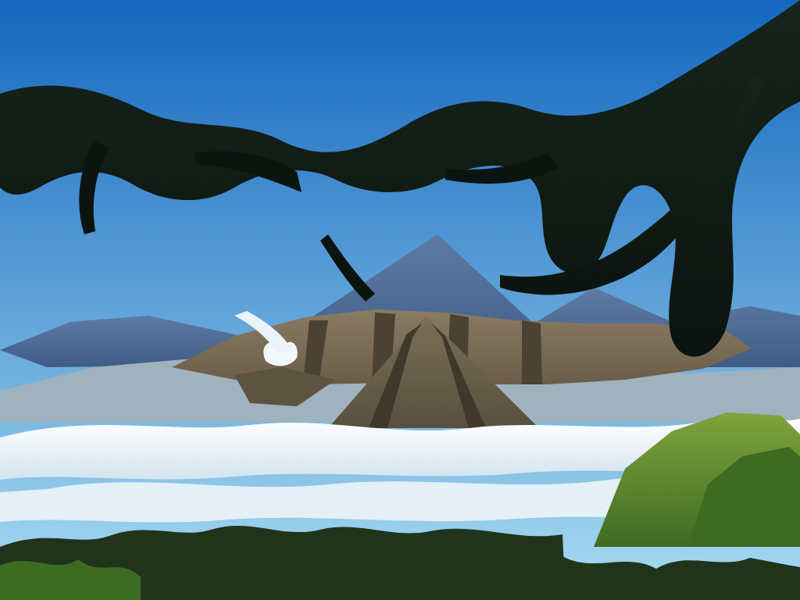
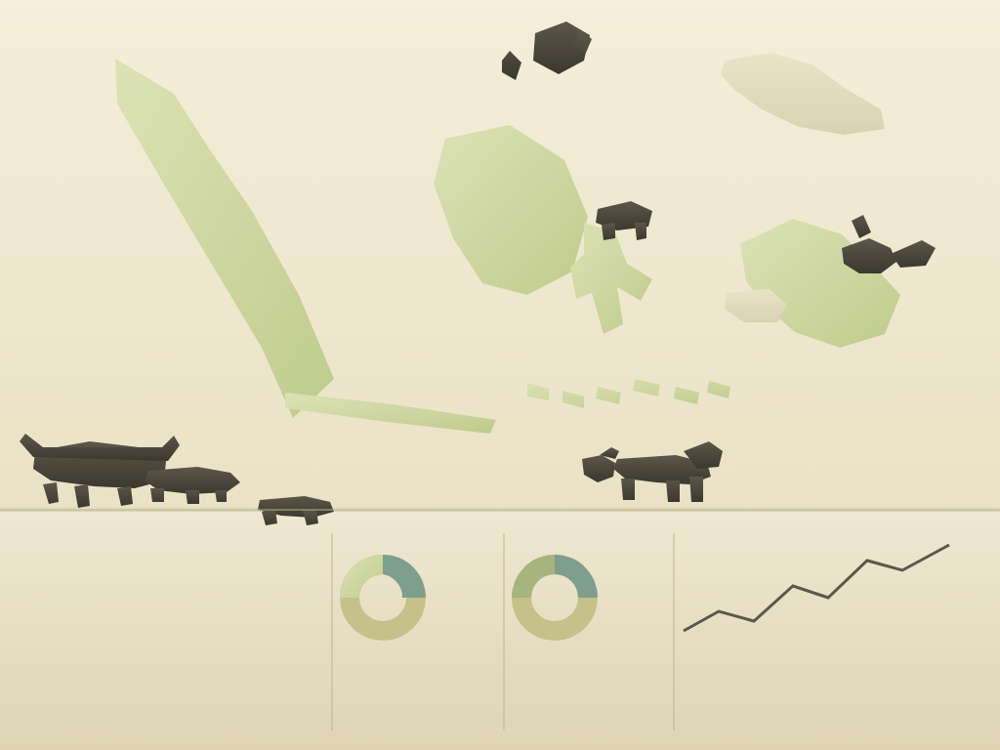
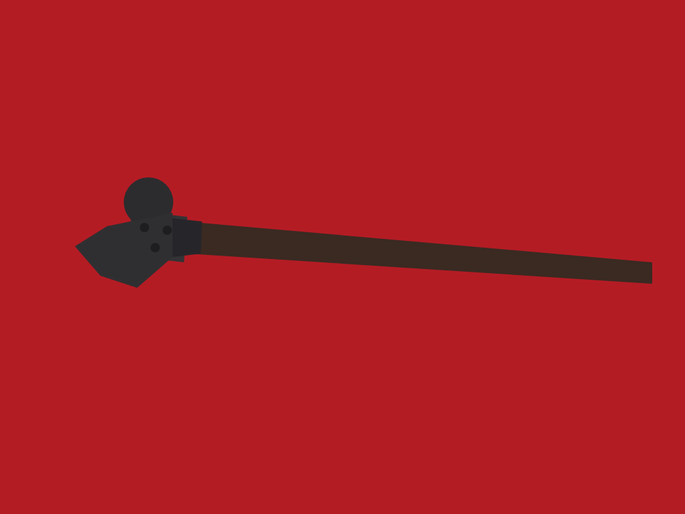
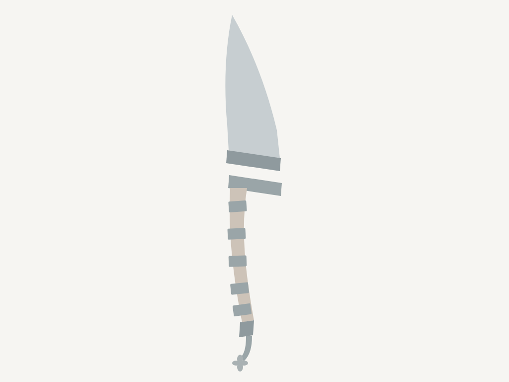

# svg-gen

Query → foto Wikimedia Commons → deepseek vision → file SVG.

Dua binary dari satu crate: `svg-gen` (CLI) dan `svg-gen-mcp` (MCP stdio server).
Tiga dependency (`ureq`, `serde_json`, `base64`). Pencarian tidak butuh API key: Wikimedia Commons
tidak pakai auth dan setiap foto membawa metadata lisensi.

## Pakai

```bash
cargo build --release

# CLI
./target/release/svg-gen "gunung bromo" -o examples/bromo.svg
./target/release/svg-gen "kapak" --mode object -o kapak.svg   # foto satu benda
./target/release/svg-gen "pisau raut" --dry-run               # cek foto pilihan, tanpa panggil model

# MCP stdio server
hermes mcp add svg-gen --command "$PWD/target/release/svg-gen-mcp"
```

```
photo: File:Pemandangan Gunung Bromo.jpg (CC BY-SA 4.0)
bytes: 346021
svg:   /.../examples/bromo.svg (4738 bytes, 28 shapes)
```

Env: `OPENAI_API_KEY` (kalau proxy minta), `SG_MODEL` (default `kn-b/deepseek-v4-1-flash`),
`SG_API` (default `http://127.0.0.1:20128/v1`).

Flag CLI: `-o/--out`, `--model`, `--mode scene|object`, `-n/--dry-run`.

## Contoh

Dibuat dengan `./make-examples.sh` (SVG + render headless Chromium). Angka penilaian di bawah adalah
hasil baca ulang render oleh model vision lain, bukan klaim pemilik repo.

| Query | Mode | Hasil | Catatan |
|---|---|---|---|
| `gunung bromo` | scene |  | 9/10 — lanskap gunung api saat sunrise, ini kasus terbaik pipeline |
| `peta indonesia` | scene |  | 6/10 — bentuk kepulauan masih dikenali, tapi model menambah donut chart & grafik yang tidak ada di foto |
| `kapak` | object |  | 6/10 — terbaca sebagai kapak, proporsi kepala terlalu kotak |
| `pisau raut` | object |  | 9/10 — bilah, bolster, gagang, dan ferrule semua ada |
| `motif dayak` | object |  | 9/10 — motif simetris terbaca sebagai ukiran Dayak |

Contoh kecil: `examples/*.svg` beberapa KB, bukan raster yang di-embed.

## Alur

1. **`find_image`** — dua query Commons (`filetype:bitmap intitle:<q>` lalu full-text), digabung,
   di-dedupe, lalu diberi skor: kata query yang muncul di judul file dibagi panjang judul. Full-text
   Commons cocok ke isi file, bukan konsep: `pisau` mengembalikan "Lambang Kabupaten Pulang Pisau",
   `kapak` mengembalikan sampul buku. Skor kepadatan judul membuang hasil seperti itu.
2. **`get`** — unduh thumbnail 768px, retry 3× dengan backoff untuk 429/5xx (Wikimedia membatasi
   burst, proxy lokal kadang 503).
3. **`ask_svg`** — gambar dikirim sebagai `image_url` data-URL bersama prompt sesuai mode. Model
   menulis SVG (`viewBox="0 0 1024 768"`, 5–25 shape, palet ≤10 warna), jawaban dipotong ke
   `<svg>…</svg>`. Tail SSE `data: [DONE]` dari proxy dibuang sebelum `serde_json`.
4. **`write_svg`** — tulis file, laporkan jumlah shape.

Mode `object` menyertakan nama subjek dari query (`Subject: kapak.`) karena tanpa itu model menebak:
satu run kapak keluar sebagai palu. Mode `scene` (default) untuk pemandangan.

## MCP

`svg-gen-mcp` bicara JSON-RPC 2.0 newline-delimited di stdio, tanpa SDK. Dua tool:

| Tool | Argumen | Kegunaan |
|---|---|---|
| `svg_from_query` | `query` (wajib), `out`, `model`, `mode` | cari foto lalu gambar |
| `svg_from_image` | `url` atau `path`, `out`, `subject`, `model`, `mode` | gambar dari sumber sendiri |

Balasan: JSON berisi `svg_path`, `source`, `license`, `model`, `mode`, `shapes`, `bytes`, dan teks
`svg` penuh supaya klien bisa langsung menampilkannya.

Daftarkan di Hermes:

```bash
hermes mcp add svg-gen --command /abs/path/target/release/svg-gen-mcp
```

Lalu `/reload-mcp` di sesi yang sedang jalan, atau buka sesi baru.

## Batas jujur

Ini **bukan** vectorisasi. Model melihat foto lalu menggambar ulang secara interpretatif:

- bagus untuk pemandangan dan objek tunggal yang siluetnya jelas;
- lemah untuk peta, diagram, dan teks — model menambah elemen yang tidak ada (lihat contoh peta);
- `temperature 0.3`, jadi hasil antar-run berbeda; satu run kapak terbaca kapak, run lain palu;
- detail kecil, tekstur, dan gradasi halus hilang.

Untuk fidelity tinggi pakai tracer (`vtracer`, `potrace`) di foto yang sama. Keduanya melengkapi,
bukan saling menggantikan.

Gambar dikirim ke proxy LLM — jangan pakai untuk foto privat.

## Lisensi

Kode: MIT (lihat `LICENSE`). Foto contoh tetap milik pemiliknya, semua via Wikimedia Commons:

| File | Lisensi |
|---|---|
| Pemandangan Gunung Bromo.jpg | CC BY-SA 4.0 |
| Peta Taman Nasional Indonesia 2022.png | CC BY-SA 4.0 |
| Kapak.jpg | CC BY 4.0 |
| Pisau-Raut.jpg | CC BY-SA 3.0 |
| Motif Dayak.jpg | CC BY-SA 4.0 |